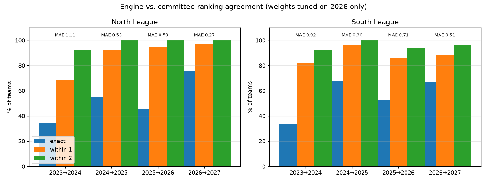

# TSA Ranking

Objective, data-driven **next-season rankings** for the Tarheel Swim
Association (TSA) from this season's dual-meet results. Replaces the by-hand
spreadsheet process described in [docs/](docs/) while following the same rules:
in-division record first, then head-to-head, point differential, and
common-opponent point differential (COPD).

## Layout

- `src/scheduling.py` – command-line entry point
- `src/tsa/` – the ranking engine
  - `config.py` – reads `data/<year>/config.yaml` (paths, aliases, weights, metrics)
  - `data.py` – loads ranks, dataclips, overrides; assigns divisions
  - `metrics.py` – pluggable per-team metrics from CSV (travel, team size, …)
  - `ranking.py` – per-team stats, weighted rating, HTH/COPD adjustment
  - `report.py` – writes outputs and compares against a reference ranking
- `src/tools/` – one-off helpers for preparing inputs (see [Tools](#tools))
- `tests/` – `pytest` smoke tests
- `docs/` – methodology notes, email threads, the original prototype
  - [docs/data-formats.md](docs/data-formats.md) – what every input/output file contains
- `data/<year>/` – one folder per season
  - `README.md` – where the inputs came from, when the run was done
  - `config.yaml` – input file names, name aliases, weights
  - `input/` – source data for that season
  - `output/` – next-season ranks + per-team report

## Setup

Python 3.12+ is required. Create a virtual environment and install dependencies:

```bash
# Linux / macOS
python3 -m venv .venv
source .venv/bin/activate
pip install -r requirements.txt
```

```powershell
# Windows (PowerShell)
python -m venv .venv
.venv\Scripts\Activate.ps1
pip install -r requirements.txt
```

The `.venv/` directory is ignored by git; `requirements.txt` is the source of
truth for dependencies. If you add a package, add it there too.

## Inputs for a season

To rank year **N** (producing N+1 ranks), `data/N/input/` holds:

| File | Required | Source | Purpose |
|---|---|---|---|
| `north_ranks.csv`, `south_ranks.csv` | yes | previous run's `output/`, or `tools/legacy_extract_rank.py` on the **N-1** workbook | Rank entering season N (`rank,team`) |
| `<N> TSA MEET RESULTS - SWIMTOPIA DATACLIPS.csv` | yes | SwimTopia export | Every dual meet with scores |
| `score_overrides.csv` | no | `tools/legacy_extract_score_overrides.py`, or by hand | Official corrections (rain-out ties recorded 1-1, etc.) |
| `team_addresses.csv` | no | `tools/scrape_team_addresses.py` | Pool address + lat/long per club |
| `team_distances.csv`, `team_drive_minutes.csv` | no | `tools/build_team_distances.py` (Google Maps) | Club-to-club road miles / drive minutes; weight 0 by default |
| `<N-1> Dual Meet Summary ... .xlsx` | no | League spreadsheet | Provenance only — the engine never reads the workbook |

Note the one-year offset: the 2026 season uses rankings produced at the end of
2025. The newest workbook (e.g. 2026) therefore lives in `data/2027/input/`,
ready for next season.

The CSVs are the canonical inputs; commit them alongside the raw sources. See
[docs/data-formats.md](docs/data-formats.md) for column/sheet details.

## Running a season

```bash
source .venv/bin/activate
python src/scheduling.py data/2026                          # writes data/2026/output/
python src/scheduling.py data/2026 --compare data/2027/input  # ...and score against a reference
python src/scheduling.py data/2026 --dry-run -q             # just the summary, write nothing
```

Outputs in `data/<year>/output/`:

- `north_ranks.csv`, `south_ranks.csv` — next season's ranks, **same format as
  the input ranks**, so they can be copied straight into `data/<year+1>/input/`.
- `ranking_report.csv` — one row per team: previous rank/division, in-division
  and overall records, point differentials, winner/loser flags, travel
  metrics, the rating and each weighted component, and a log of every HTH/COPD
  swap that moved the team. This is the committee's discussion document.

Season checklist:

1. Create `data/<year>/` (copy an existing year's folder; clear `output/`).
2. Copy last season's `output/*_ranks.csv` into `input/` (or extract them from
   the legacy workbook with the tool below).
3. Drop in the SwimTopia dataclip CSV; set `inputs.dataclips` in `config.yaml`.
4. Add `score_overrides.csv` for any meets the league ruled differently than
   the dataclip shows.
5. If a club joined, add it to `new_teams` in `config.yaml`; clubs that left
   are dropped automatically (ranked but swam no meets).
6. Optionally refresh `team_addresses.csv` and the distance matrices.
7. Run the engine, review `ranking_report.csv`, fill in `data/<year>/README.md`,
   commit inputs + config + outputs together.

## How the ranking works

1. **Divisions** are derived from the incoming ranks: 4-team divisions from the
   top, with the remainder forming 3-team divisions at the bottom (37 teams →
   7×4 + 3×3). A meet is "in-division" when both clubs share a league and
   division.
2. **Stats** per team: in-division and overall W-L-T, point differentials, and
   division winner/loser (best/worst in-division record, tie broken on
   in-division differential — the committee's practice).
3. **Rating** = Σ weight × factor. Built-in factors come from the meet results
   (`weights:` in `config.yaml`):

   | weight | factor | 2026 value |
   |---|---|---|
   | `previous_rank` | positions above the bottom of the league | 25 / rank |
   | `division_record` | in-division wins − losses | 0 |
   | `overall_record` | overall wins − losses | 15 |
   | `division_winner` / `division_loser` | flat bonus / penalty | +40 / −60 |
   | `division_point_diff`, `overall_point_diff` | per point | 0 |

   With `previous_rank` at 25, 100 points ≈ one division (4 ranks).

   **Any other "one number per team" is a pluggable metric** (`metrics:` in
   `config.yaml`) — no code changes needed:

   ```yaml
   metrics:
     travel_distance:                # name -> m_/c_ columns in the report
       file: team_distances.csv      # relative to data/<year>/input/
       source: matrix_row_mean       # team x team matrix -> mean over your league
       normalize: minmax_league      # none | minmax_league (0..1) | zscore_league
       direction: lower_is_better    # or higher_is_better
       weight: 0.0
     team_size:
       file: team_metrics.csv        # any CSV with a `team` column
       column: swimmers              # source: column (default)
       weight: 0.0
   ```

   Values are normalised within each league and sign-adjusted so that
   "better" is positive, then multiplied by `weight`. A weight-0 metric whose
   file is missing is skipped; a non-zero one must load for every team. The
   two travel metrics ship at weight 0.
4. **Adjustment**: teams are sorted by rating, then bubble passes swap adjacent
   pairs where the lower team **beat the upper head-to-head** (gap ≤
   `hth_max_rating_gap`) or, if they never met, holds a **COPD** edge of at
   least `copd_min_margin` (gap ≤ `copd_max_rating_gap`). Every swap is
   logged in the report.

The 2026 weights were tuned against the committee's approved 2027 ranking with
`tools/tune_weights.py`. Applied unchanged to 2023–2025 (out-of-sample), the
engine matches the committee within one place for 88% of 352 team-seasons and
within two places for 97%; re-tuning on all four seasons pooled finds no
better weights. Full tables, chart, and per-team misses:
[docs/accuracy_summary.md](docs/accuracy_summary.md).



## Tools

Helper scripts in `src/tools/` prepare inputs or tune the engine. They are run
once per season and are independent of the ranking code.

### `summarize_accuracy.py` — engine vs. committee, every season

Runs each `data/<year>/` that has a following year's reference ranks, and
writes [docs/accuracy_summary.md](docs/accuracy_summary.md) (tables + per-team
misses) and `docs/accuracy_summary.png` (chart).

```bash
python src/tools/summarize_accuracy.py
```

### `legacy_extract_score_overrides.py` — official score corrections

Diffs the dataclip against the `Results` sheet of the *same* season's Dual
Meet Summary workbook and writes every disagreement to `score_overrides.csv`
(`date,team_a,team_b,score_a,score_b,note`). Pass `--config` so older
dataclips' long club names are aliased. In 2026 this captured 11
rain-shortened meets the league recorded as 1-1 / 1-0.

```bash
python src/tools/legacy_extract_score_overrides.py \
  "data/2027/input/2026 Dual Meet Summary v.4.0 - MN Copy.xlsx" \
  "data/2026/input/2026 TSA MEET RESULTS - SWIMTOPIA DATACLIPS.csv" \
  --config data/2026/config.yaml
```

Once the workbook is retired, maintain this file by hand.

### `tune_weights.py` — fit weights to a reference ranking

Coordinate-descent over every numeric knob in `config.yaml`, minimising mean
absolute rank error against a reference `north_ranks.csv`/`south_ranks.csv`.
Prints the best weights as YAML; never writes files. Try a few `--seed`s — the
landscape has several local optima. Add `--tune-metrics` to also search the
weights of declared `metrics:`.

```bash
python src/tools/tune_weights.py data/2026 data/2027/input --iters 6 --seed 3
```

### `legacy_extract_rank.py` — rankings from the legacy workbook

Pulls the hand-calculated "proposed next-season rank" out of the workbook's
`North Report` and `South Report` sheets into two CSVs:

```bash
python src/tools/legacy_extract_rank.py "data/2027/input/2026 Dual Meet Summary v.4.0 - MN Copy.xlsx"
# North Report: 37 teams -> data/2027/input/north_ranks.csv
# South Report: 51 teams -> data/2027/input/south_ranks.csv
```

Output format (`rank,team`, sorted by rank):

```
rank,team
1,Seven Oaks
2,University Club
...
```

- CSVs are written next to the workbook by default; `--out-dir` overrides.
- `--current` writes the rank each team *held* that season (column D) instead
  of the proposal — used to reconstruct 2023's incoming ranks because the 2022
  workbook was never filled in.
- **Requires** both `North Report` and `South Report` sheets; exits non-zero
  if either is missing.
- Reads column A (rank) and column B (team) from row 4, skips the
  `**Any New Teams to be added here…` placeholder, and validates that ranks
  are contiguous `1..N` with no duplicate names.
- A workbook whose Report sheets are unfilled (e.g. the 2022 file, all
  `#N/A`) is rejected rather than producing an empty CSV.

### `scrape_team_addresses.py` — club addresses from SwimTopia

Scrapes the TSA SwimTopia roster page and each club page for the pool
address and lat/long:

```bash
python src/tools/scrape_team_addresses.py --out data/2026/input/team_addresses.csv
```

Output columns: `division, team, url, address, latitude, longitude, note`.
Addresses come from the Google Maps snippet on each club page; a club with no
map snippet falls back to the address text on the page and is flagged in
`note` (currently only Preston Village, which therefore has no lat/long).

Club names on the website differ slightly from the Dual Meet Summary in a few
cases (e.g. `Lakepark` vs `Lake Park`, `Brier Creek Country Club` vs
`Brier Creek`), so joining to `*_ranks.csv` needs a small alias map.

### `build_team_distances.py` — road distance matrices via Google Maps

Calls the Google **Routes API** (`computeRouteMatrix`) for every club pair in
`team_addresses.csv` and writes two square CSVs (clubs as first row and first
column, diagonal = 0):

- `team_distances.csv` – driving distance in miles (1 decimal)
- `team_drive_minutes.csv` – typical driving time in minutes

```bash
export GOOGLE_MAPS_API_KEY=...        # never commit this
python src/tools/build_team_distances.py data/2026/input/team_addresses.csv --dry-run
python src/tools/build_team_distances.py data/2026/input/team_addresses.csv
```

- Clubs are located by lat/long when present, else by address string.
- Requests are batched 10×10; 88 clubs → ~81 requests / ~7,700 billed
  elements, inside Google's monthly free tier. (Larger blocks caused the API
  to return truncated/cancelled elements.)
- Raw results are cached in `team_distances_cache.json` beside the output, so
  re-running only fetches pairs not already cached, and transient failures
  are retried automatically. Commit the cache along with the CSVs.
  with the CSVs.
- Exits 2 (and leaves blanks) if Google returns no route for a pair.

To get a key: Google Cloud Console → APIs & Services → Library → enable
**Routes API** → Credentials → Create API key. Restrict it to the Routes API.
(The older standalone "Distance Matrix API" is legacy and no longer offered
to new projects.)
